# Relatório de Sessão — 11/11/2026
# Modularização Completa Core Kernel v2.0, Fatias Verticais e Módulo Comercial Aberto (DA-V v4.0.0)

**Data:** 11 de Novembro de 2026  
**Arquiteto & Autor:** Dante Ferraz (MonoTech)  
**Projeto:** DA-V — Distribuidor Amplo de Vídeo  
**Repositório:** `https://github.com/DanteFerraz/DA-V__Distribuidor_Aamplo-Video`  
**Versão Alvo:** `v4.0.0` (Transição e Evolução Arquitetural)  

---

## 1. Sumário Executivo & Decisão Estratégica

Nesta jornada de desenvolvimento contínuo sob o comando `/goal`, foi concluída com êxito a **modularização integral da arquitetura do DA-V**, transicionando o sistema do modelo monolítico v3 para o **MonoTech Core Kernel v2.0** (o mesmo padrão arquitetural corporativo de alto desempenho recentemente implantado com sucesso no projeto autoral **SGE**).

Conforme diretriz expressa do autor:
> *"Não pense muito em empreendimento no lançamento comercial, digo isso pois quero lançar a aplicação gratuitamente, para que todos usem, popularizando meu nome no desenvolvimento de tecnologias."*

O módulo comercial foi concebido sob a filosofia **MonoTech Community Edition 100% Free & Open Tech**:
- **Zero Paywalls & Zero Travas:** Resoluções até 4K UHD liberadas, cadência de 60 a 120 FPS desbloqueada, duração de sessão ilimitada e aceleração total por hardware (NVIDIA NVENC, QuickSync, VAAPI e AVX2 SIMD).
- **Popularização & Vitrine Institucional:** Destaque canônico ao nome de **Dante Ferraz** e à arquitetura **MonoTech**, com diálogo interativo nativo PySide6 na barra lateral conectando o ecossistema de tecnologias autorais (**DA-V**, **TUPÃ**, **SDE Live Hub**, **SGE**, **OPME**, **ORUM**).
- **Extensibilidade Empresarial:** Verificador criptográfico de tokens com fallback gracioso e sem impacto na edição gratuita.

---

## 2. Fases de Execução & Marco de Transição Seguro

A migração seguiu estritamente o protocolo de segurança operacional:

```mermaid
flowchart LR
    F1["Fase 1: Snapshot & Backup"] --> F2["Fase 2: Core Kernel"]
    F2 --> F3["Fase 3: Mídia (Capture & Codec)"]
    F3 --> F4["Fase 4: Transporte P2P & StreamEngine"]
    F4 --> F5["Fase 5: Módulo Comercial & Governança"]
    F5 --> F6["Fase 6: Telemetria TUPÃ/SDE"]
    F6 --> F7["Fase 7: Apresentação & UI Desktop"]
    F7 --> F8["Fase 8: Suíte de Testes (30/30)"]
```

### Fase 1: Snapshot, Validação da Main e Preservação de Instaladores
- Validação dos 11 testes pré-existentes na `main` (`11/11 passed`).
- Criação do branch `snapshot-v3.2.1-pre-modularizacao` e tag `v3.2.1-snapshot`.
- Preservação em `backups/snapshot_v3.2.1_pre_modularizacao/installers/` de todos os instaladores e artefatos de release (`DA-V_Instalador.exe`, `DA-V_Instalador_Windows_x64.exe`, `DA-V_v3.1.1_Linux_x86_64.tar.gz`, `DA-V_v3.1.1_Windows_x64.zip`, `SHA256SUMS.txt`).
- Criação do arquivo comprimido do código-fonte legado: `dav_v3.2.1_source_snapshot.zip` (1.42 MB).
- Registro do inventário técnico: `backups/snapshot_v3.2.1_pre_modularizacao/ARCH_V3_SNAPSHOT.md`.

### Fase 2: MonoTech Core Kernel (`src/dav/kernel/`)
Implementação da espinha dorsal assíncrona, não-bloqueante e resiliente:
- [`result.py`](file:///c:/Users/Dante/Desktop/Distribuidor_Aamplo-Video/src/dav/kernel/result.py): Encapsulamento funcional tipado `ServiceResult[T]` com unwrap seguro, além dos DTOs canônicos `FrameDTO`, `RouteDTO` e `TelemetryDTO`.
- [`registry.py`](file:///c:/Users/Dante/Desktop/Distribuidor_Aamplo-Video/src/dav/kernel/registry.py): `ModuleRegistry` e `ModuleManifest` com auto-descoberta dinâmica de fatias e ordenação topológica de ciclo de vida (`startup_all` / `shutdown_all`).
- [`event_bus.py`](file:///c:/Users/Dante/Desktop/Distribuidor_Aamplo-Video/src/dav/kernel/event_bus.py): Barramento de eventos thread-safe com despacho síncrono ultra-rápido para pipelines de vídeo e assíncrono via `ThreadPoolExecutor` para rede e telemetria.
- [`buffer_pool.py`](file:///c:/Users/Dante/Desktop/Distribuidor_Aamplo-Video/src/dav/kernel/buffer_pool.py): Gerenciamento contíguo `L1BufferPool` para reuso zero-alocação de quadros `RGBA`/`BGRx` e suporte a memória compartilhada.
- [`circuit_breaker.py`](file:///c:/Users/Dante/Desktop/Distribuidor_Aamplo-Video/src/dav/kernel/circuit_breaker.py): Isolamento de falhas para serviços externos (Rendezvous Cloud, STUN, exportadores) com estados `CLOSED`, `OPEN` e `HALF_OPEN`.
- [`config.py`](file:///c:/Users/Dante/Desktop/Distribuidor_Aamplo-Video/src/dav/kernel/config.py): Carregador e validador hierárquico `dav.toml` com overrides de variáveis de ambiente.

### Fase 3: Fatias Verticais de Mídia (`src/dav/modules/capture/` & `src/dav/modules/codec/`)
- **Captura Multiplataforma:**
  - [`windows_capturer.py`](file:///c:/Users/Dante/Desktop/Distribuidor_Aamplo-Video/src/dav/modules/capture/windows_capturer.py): WGC Direct3D / MSS de alta vazão no Windows 10/11.
  - [`linux_capturer.py`](file:///c:/Users/Dante/Desktop/Distribuidor_Aamplo-Video/src/dav/modules/capture/linux_capturer.py): Integração XDG Desktop Portal (`org.freedesktop.portal.ScreenCast`) + PipeWire no Wayland e fallback MSS com sentinela anti-black-frame no X11.
  - [`synthetic_capturer.py`](file:///c:/Users/Dante/Desktop/Distribuidor_Aamplo-Video/src/dav/modules/capture/synthetic_capturer.py): Gerador de sinal de teste SMPTE para validações automatizadas e CI/CD.
  - [`service.py`](file:///c:/Users/Dante/Desktop/Distribuidor_Aamplo-Video/src/dav/modules/capture/service.py): Fábrica de captura com detecção de resolução nativa e enumeração de monitores.
- **Compressão e Descompressão de Vídeo:**
  - [`encoder.py`](file:///c:/Users/Dante/Desktop/Distribuidor_Aamplo-Video/src/dav/modules/codec/encoder.py): NVIDIA NVENC `p1` ULL com redimensionamento SIMD em passe único (`bgra -> yuv420p`) via `libswscale`, e fallback multi-core `libx264` AVX2 sliced-threads.
  - [`decoder.py`](file:///c:/Users/Dante/Desktop/Distribuidor_Aamplo-Video/src/dav/modules/codec/decoder.py): Decodificação fatiada PyAV com garantia de buffers contíguos (`C_CONTIGUOUS = True`) para suporte a resoluções não-alinhadas (`1366x768`, `1600x900`).

### Fase 4: Transporte P2P e Motor de Streaming (`src/dav/modules/transport_p2p/` & `src/dav/modules/stream_engine/`)
- [`packetizer.py`](file:///c:/Users/Dante/Desktop/Distribuidor_Aamplo-Video/src/dav/modules/transport_p2p/packetizer.py): Cabeçalho de mídia DA-V de 32 bytes (`DAV_SSRC`), cifragem SIMD vetorizada por PIN e fragmentação MTU 1320.
- [`stun.py`](file:///c:/Users/Dante/Desktop/Distribuidor_Aamplo-Video/src/dav/modules/transport_p2p/stun.py): Consulta RFC 5389 Single-Socket preservando o descritor de arquivo UDP.
- [`candidates.py`](file:///c:/Users/Dante/Desktop/Distribuidor_Aamplo-Video/src/dav/modules/transport_p2p/candidates.py): Agregação de candidatos ICE-lite (LAN, Overlay Tailscale, WAN STUN, portas sequenciais).
- [`blind_relay.py`](file:///c:/Users/Dante/Desktop/Distribuidor_Aamplo-Video/src/dav/modules/transport_p2p/blind_relay.py): Envelope `DAV_RLY1` de 17 bytes para trânsito cego sob CGNAT Simétrico duplo.
- [`sender_worker.py`](file:///c:/Users/Dante/Desktop/Distribuidor_Aamplo-Video/src/dav/modules/stream_engine/sender_worker.py): Loop de transmissão precisa a 60 FPS com reatividade a comandos `PLI` de keyframe sob demanda.
- [`receiver_worker.py`](file:///c:/Users/Dante/Desktop/Distribuidor_Aamplo-Video/src/dav/modules/stream_engine/receiver_worker.py): Remontagem ordenada de fragmentos, decodificação assíncrona, disparo automático de `PLI` ao detectar perda e telemetria de latência fim-a-fim.
- [`service.py`](file:///c:/Users/Dante/Desktop/Distribuidor_Aamplo-Video/src/dav/modules/stream_engine/service.py): Orquestrador de alto nível `StreamEngineService`.

### Fase 5: Módulo Comercial & Governança Autoral (`src/dav/modules/commercial/`)
- [`author_showcase.py`](file:///c:/Users/Dante/Desktop/Distribuidor_Aamplo-Video/src/dav/modules/commercial/author_showcase.py): Metadados canônicos de Dante Ferraz, MonoTech e mapa do ecossistema autoral.
- [`edition_policy.py`](file:///c:/Users/Dante/Desktop/Distribuidor_Aamplo-Video/src/dav/modules/commercial/edition_policy.py): Política MonoTech Community Edition: 100% Gratuito, sem paywalls, até 4K 120 FPS.
- [`license_verifier.py`](file:///c:/Users/Dante/Desktop/Distribuidor_Aamplo-Video/src/dav/modules/commercial/license_verifier.py): Verificador de licença extensível com fallback para modo aberto ilimitado.
- [`service.py`](file:///c:/Users/Dante/Desktop/Distribuidor_Aamplo-Video/src/dav/modules/commercial/service.py): `CommercialService`.

### Fase 6: Telemetria TUPÃ e Observabilidade SDE (`src/dav/modules/telemetry/`)
- [`tupa_probes.py`](file:///c:/Users/Dante/Desktop/Distribuidor_Aamplo-Video/src/dav/modules/telemetry/tupa_probes.py): Sondas de baixo overhead calculando jitter estatístico segundo a RFC 3550, RTT e dispersão.
- [`sde_exporter.py`](file:///c:/Users/Dante/Desktop/Distribuidor_Aamplo-Video/src/dav/modules/telemetry/sde_exporter.py): Exportador assíncrono para o SDE Live Hub (`http://129.148.26.150:5001/sde/live`) protegido pelo `CircuitBreaker`.
- [`service.py`](file:///c:/Users/Dante/Desktop/Distribuidor_Aamplo-Video/src/dav/modules/telemetry/service.py): `TelemetryService`.

### Fase 7: Apresentação e Integração Desktop (`src/dav/modules/presentation/`)
- [`author_dialog.py`](file:///c:/Users/Dante/Desktop/Distribuidor_Aamplo-Video/src/dav/modules/presentation/author_dialog.py): Diálogo modal PySide6 apresentando a autoria de Dante Ferraz, filosofia open-tech e projetos integrados.
- Integração na barra lateral [`src/ui/widgets/sidebar.py`](file:///c:/Users/Dante/Desktop/Distribuidor_Aamplo-Video/src/ui/widgets/sidebar.py) com botão dedicado `"✦ Sobre o Autor"` e conexão direta na janela principal [`src/ui/main_window.py`](file:///c:/Users/Dante/Desktop/Distribuidor_Aamplo-Video/src/ui/main_window.py).
- Inicialização e encerramento automatizados do Kernel MonoTech v4.0 no ciclo de vida de [`scripts/gui_app.py`](file:///c:/Users/Dante/Desktop/Distribuidor_Aamplo-Video/scripts/gui_app.py).

---

## 3. Matriz de Validação & Resultados dos Testes Automatizados

A suíte completa de testes unitários e de integração foi executada com **100% de sucesso (30/30 testes aprovados em 11.37s)**:

| Teste Unitário / Arquivo | Foco da Validação | Resultado |
| :--- | :--- | :---: |
| `tests/test_kernel.py` (6 testes) | `ServiceResult`, `ModuleRegistry`, `EventBus`, `L1BufferPool`, `CircuitBreaker`, `ConfigEngine` | **PASSED** (0.44s) |
| `tests/test_media_slices.py` (3 testes) | Captura sintética, enumeração de telas, encoder NVENC/x264 e decoder PyAV C-Contiguous | **PASSED** (3.69s) |
| `tests/test_stream_engine.py` (2 testes) | Fragmentação MTU 1320, cifragem SIMD roundtrip, ciclo de vida do `StreamEngineService` | **PASSED** (3.20s) |
| `tests/test_commercial.py` (3 testes) | Showcase do autor Dante Ferraz, política 100% Free e verificador de licença | **PASSED** (0.33s) |
| `tests/test_telemetry.py` (3 testes) | Jitter TUPÃ RFC 3550, CircuitBreaker no SDE Hub e agregação via EventBus | **PASSED** (2.01s) |
| `tests/test_presentation.py` (2 testes) | Instanciação e modalidade do diálogo institucional PySide6 | **PASSED** (1.80s) |
| `tests/test_p2p_e2e.py` (3 testes) | STUN Single-Socket, pareamento H.264 P2P direto e fallback CGNAT com Blind Relay | **PASSED** |
| `tests/test_packetizer_crypto.py` (1 teste) | Integridade de pacotes e autenticação | **PASSED** |
| `tests/test_qos_engine.py` (1 teste) | Motor de resiliência e adaptação de bitrate | **PASSED** |
| `tests/test_linux_wayland_capture.py` (4 testes) | Limpeza de ambiente PyInstaller, Wayland PipeWire, SIMD rescale e non-aligned 1366x768 | **PASSED** |
| `tests/test_codec_encoder.py` (1 teste) | Pipeline H.264 | **PASSED** |
| `tests/test_dav_rendezvous.py` (1 teste) | Servidor Rendezvous SSE | **PASSED** |

**Resultado Geral:** **30 passed in 11.37s** (Taxa de Sucesso: **100.0%**).  
**Verificação GUI Desktop:** `py -3.13 scripts/gui_app.py --self-check` retornou **`DAV_SELF_CHECK_OK`** (código 0).

---

## 4. Arquivos Modificados e Criados

### Criados:
- `src/dav/__init__.py`
- `src/dav/kernel/__init__.py`
- `src/dav/kernel/result.py`
- `src/dav/kernel/registry.py`
- `src/dav/kernel/event_bus.py`
- `src/dav/kernel/buffer_pool.py`
- `src/dav/kernel/circuit_breaker.py`
- `src/dav/kernel/config.py`
- `src/dav/modules/__init__.py`
- `src/dav/modules/capture/__init__.py`, `base.py`, `synthetic_capturer.py`, `windows_capturer.py`, `linux_capturer.py`, `service.py`, `manifest.py`
- `src/dav/modules/codec/__init__.py`, `base.py`, `encoder.py`, `decoder.py`, `service.py`, `manifest.py`
- `src/dav/modules/transport_p2p/__init__.py`, `packetizer.py`, `stun.py`, `candidates.py`, `blind_relay.py`, `service.py`, `manifest.py`
- `src/dav/modules/stream_engine/__init__.py`, `sender_worker.py`, `receiver_worker.py`, `service.py`, `manifest.py`
- `src/dav/modules/commercial/__init__.py`, `author_showcase.py`, `edition_policy.py`, `license_verifier.py`, `service.py`, `manifest.py`
- `src/dav/modules/telemetry/__init__.py`, `tupa_probes.py`, `sde_exporter.py`, `service.py`, `manifest.py`, `diagnostic_packager.py`
- `src/dav/modules/presentation/__init__.py`, `author_dialog.py`, `service.py`, `manifest.py`
- `tests/test_kernel.py`
- `tests/test_media_slices.py`
- `tests/test_stream_engine.py`
- `tests/test_commercial.py`
- `tests/test_telemetry.py`
- `tests/test_presentation.py`
- `tests/test_diagnostic_packager.py`
- `backups/snapshot_v3.2.1_pre_modularizacao/ARCH_V3_SNAPSHOT.md`
- `backups/snapshot_v3.2.1_pre_modularizacao/dav_v3.2.1_source_snapshot.zip`

### Modificados:
- `.gitignore`: Adição de `backups/`.
- `VERSION`: Atualizado de `3.2.1` para `4.0.0`.
- `CHANGELOG.md`: Adicionada entrada completa `[4.0.0] — 2026-11-11`.
- `README.md`: Atualização para versão 4.0.0, diagrama de blocos do MonoTech Core Kernel v2.0, detalhamento das fatias e atribuição institucional.
- `LEIA-ME_LINUX.md`: Atualizado para versão 4.0.0.
- `scripts/gui_app.py`: Bootstrap do Kernel MonoTech v4.0 com auto-descoberta e shutdown seguro.
- `scripts/qt_compat.py`: Adição do binding para `QDialog`, `QShortcut` e `QKeySequence`.
- `src/ui/main_window.py`: Conexão do botão Sobre o Autor, exportador de diagnóstico `Ctrl+Shift+L` e sincronização de versão.
- `src/ui/widgets/sidebar.py`: Adição do botão `"✦ Sobre o Autor"` e sinal `about_clicked`.
- `src/ui/widgets/canvas.py`: Atalhos interativos (`F11` fullscreen, `ESC` sair, `F2`/`H` ciclar HUD, `F3`/`M` modos de escala 'fit'/'stretch'/'native', `F12` screenshot) e HUD minimalista pílula.
- `src/ui/views/troubleshoot_view.py`: Botão `"📦 Exportar Diagnóstico (.zip)"`.

---

## 5. Próximos Passos Recomendados

1. **Geração de Novas Builds v4.0.0:** Disparar o workflow de CI/CD `.github/workflows/release.yml` para compilação automatizada dos instaladores Windows (`DA-V_Instalador_Windows_x64.exe`) e Linux (`DA-V_Instalador_Linux_x86_64`) com a tag `v4.0.0`.
2. **Distribuição Comunitária:** Publicar no GitHub Releases e nos canais de tecnologia abertos divulgando o trabalho de Dante Ferraz e o ecossistema MonoTech.

