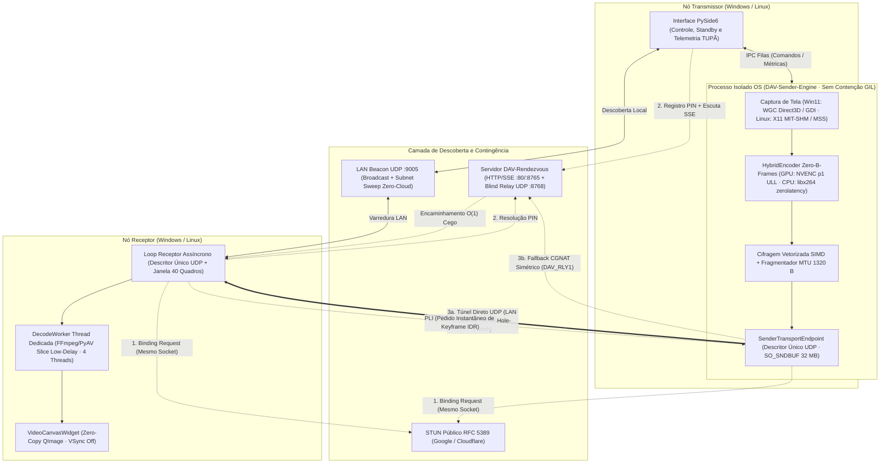
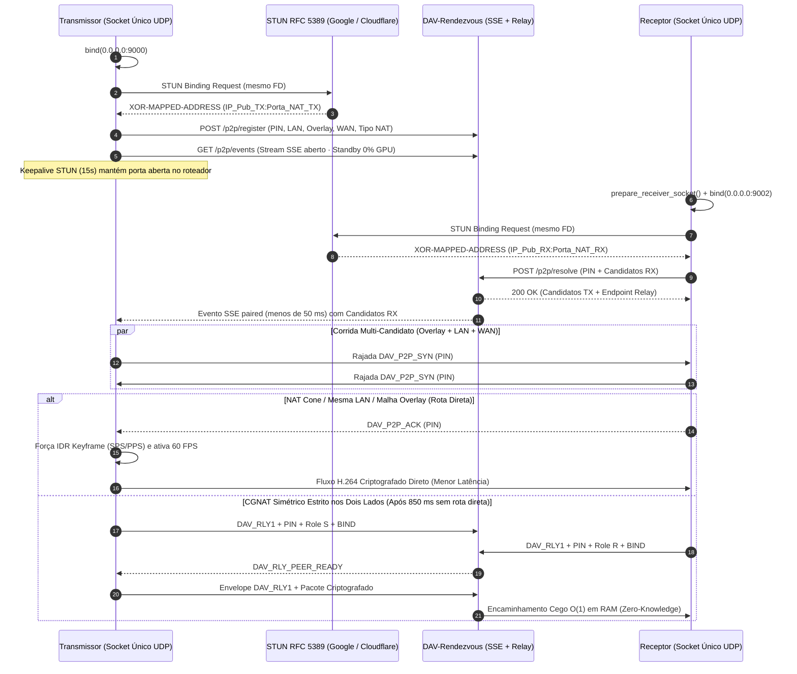

# DA-V · Distribuidor Amplo de Vídeo

<div align="center">


**Compartilhamento de tela ponto a ponto de baixa latência a 60 FPS reais entre Windows e Linux — com pareamento universal por PIN, perfuração direta de NAT e fallback automático para CGNAT.**

[Arquitetura de Software](#arquitetura-de-software) •
[Protocolo P2P e Travessia de NAT](#engenharia-p2p-stun-single-socket-e-blind-relay) •
[Formato de Pacote na Rede](#protocolo-binário-de-transporte) •
[Como Executar](#instalação-e-execução) •
[Releases & Builds](https://github.com/DanteFerraz/DA-V__Distribuidor_Aamplo-Video/releases)

</div>

---

## Motivação Técnica

Quem trabalha com revisão de vídeo, CAD, telemetria em tempo real ou suporte técnico remoto conhece a limitação das ferramentas tradicionais de videoconferência: o fluxo de tela costuma ser reduzido para 15–30 FPS, passa por pilhas genéricas cheias de *jitter buffers* conservadores (150 ms a 300 ms) e depende de servidores intermediários que recomprimem a imagem.

O **DA-V (Distribuidor Amplo de Vídeo)** foi construído do zero para resolver um problema específico de engenharia de sistemas: **transportar a área de trabalho a 1080p e 60 quadros por segundo constantes entre máquinas Windows e Linux, mantendo a latência de rede na casa de poucos milissegundos na LAN e atravessando roteadores residenciais/corporativos na WAN usando apenas um código PIN de 6 dígitos.**

Em vez de embutir um navegador inteiro (Electron/WebRTC), o DA-V separa estritamente a interface gráfica (PySide6 com apresentação imediata `SwapInterval=0`) do motor de captura, compressão e rede — operando em processos isolados do sistema operacional para eliminar qualquer interferência do *Global Interpreter Lock* (GIL) ou do escalonador de janelas sobre a cadência de 16,66 ms por quadro.

---

## Arquitetura de Software

O projeto adota uma **arquitetura multiprocesso desacoplada** com protocolo de rede unificado entre Windows e Linux, acompanhada de módulos nativos em **C++23** (`libdav_core.so` / `dav_daemon`) para cenários embarcados e *headless*.



### Decisões de Projeto que Sustentam os 60 FPS

1. **Isolamento de Processo na Transmissão (`scripts/dav_sender_worker.py`):** A captura de vídeo, a codificação H.264 e o disparo de datagramas rodam em um processo separado criado via `spawn`, com prioridade elevada no kernel (`ABOVE_NORMAL_PRIORITY_CLASS` + `timeBeginPeriod(1)` no Windows; `os.nice(-10)` no Linux). Mover ou redimensionar a janela da GUI nunca atrasa a entrega de um quadro.
2. **Cascata Multiplataforma de Codificação (`src/codec/hybrid_codec.py`):** Se uma GPU NVIDIA estiver presente, o `HybridEncoder` utiliza o silício dedicado `h264_nvenc` (preset `p1`, `zerolatency`, zero quadros B e repetição automática de cabeçalhos `SPS/PPS`). Em estações Linux ou notebooks sem GPU dedicada, o motor recua automaticamente para `libx264` (`ultrafast` + `sliced-threads`) via FFmpeg/PyAV — mantendo 100% de compatibilidade binária entre Windows e Linux sem exigir OpenCV instalado.
3. **Modo Standby On-Demand (0% GPU):** Ao iniciar o compartilhamento em modo PIN, o transmissor registra o endpoint público e permanece em espera consumindo 0% de captura/GPU, enviando apenas *keepalives* STUN de 20 bytes a cada 15 segundos para preservar a porta mapeada no roteador até que um receptor se conecte.
4. **Sincronia Instantânea de Quadro-Chave (PLI):** Redes UDP reais perdem pacotes justamente nos primeiros milissegundos da abertura de um NAT. Sempre que o handshake `SYN/ACK` fecha — ou caso o receptor detecte pacotes `P-frame` sem `IDR` inicial por mais de 200 ms — um sinal leve `DAV_P2P_PLI` instrui o encoder a emitir imediatamente um quadro `IDR + SPS/PPS`, eliminando telas pretas ou artefatos cinzas na entrada da sessão.

---

## Engenharia P2P: STUN Single-Socket e Blind Relay

Um erro clássico em implementações caseiras de P2P é consultar um servidor STUN usando um socket temporário, fechá-lo e abrir outro socket para o streaming: o roteador atribui uma porta externa nova ao segundo socket e o *Hole-Punching* falha silenciosamente.

No **DA-V v3.1**, toda a negociação ocorre **sobre o exato mesmo descritor de arquivo UDP** que enviará e receberá os fragmentos H.264:



### Estratégia de Seleção de Rota (ICE-Lite Autoral)

Ao parear um PIN, ambos os lados constroem uma lista ordenada de candidatos e os sondam em paralelo:
1. **Malhas Overlay (`100.64.0.0/10`) e Interfaces LAN Físicas (`192.168.x.x`, `10.x.x.x`):** Testadas primeiro para contornar roteadores domésticos que bloqueiam *NAT Hairpinning* quando transmissor e receptor estão no mesmo escritório/residência.
2. **Endpoint WAN Reflexivo (`XOR-MAPPED-ADDRESS`):** Mapeado via RFC 5389 diretamente no socket de mídia, acompanhado de predição de portas contíguas (`±1`) para roteadores residenciais de alocação linear.
3. **Blind Encrypted UDP Relay (`DAV_RLY1`):** Se após `850 ms` nenhum pacote direto atravessar (cenário típico de **CGNAT Simétrico** em operadoras fibra ou redes móveis 4G/5G), os clientes envelopam os datagramas já criptografados e os encaminham via porta UDP `8768` do servidor `DAV-Rendezvous`, que faz o repasse em memória `O(1)` sem jamais ter acesso à chave derivada do PIN.
4. **Contingência Zero-Cloud (LAN Beacon):** Caso a internet externa esteja indisponível, o receptor resolve o próprio código PIN localmente via broadcast/varredura de sub-rede na porta `9005/udp`.

---

## Protocolo Binário de Transporte

Cada quadro comprimido pelo `HybridEncoder` é criptografado em bloco vetorizado e fatiado em datagramas de até **1320 bytes de carga útil** — dimensão escolhida deliberadamente para ficar abaixo do MTU efetivo de enlaces PPPoE, túneis WireGuard e redes móveis 5G sem sofrer fragmentação IP no caminho.

### Cabeçalho de Mídia DA-V (32 Bytes · Network Big-Endian `!BBBBIIQIIHH`)

```text
 0                   1                   2                   3
 0 1 2 3 4 5 6 7 8 9 0 1 2 3 4 5 6 7 8 9 0 1 2 3 4 5 6 7 8 9 0 1
+-+-+-+-+-+-+-+-+-+-+-+-+-+-+-+-+-+-+-+-+-+-+-+-+-+-+-+-+-+-+-+-+
|  Version (1)  |  Packet Type  |     Flags     |   Reserved    |  Bytes 0..3
+-+-+-+-+-+-+-+-+-+-+-+-+-+-+-+-+-+-+-+-+-+-+-+-+-+-+-+-+-+-+-+-+
|                        Sequence Number                        |  Bytes 4..7
+-+-+-+-+-+-+-+-+-+-+-+-+-+-+-+-+-+-+-+-+-+-+-+-+-+-+-+-+-+-+-+-+
|                     SSRC (0x00DA0001)                         |  Bytes 8..11
+-+-+-+-+-+-+-+-+-+-+-+-+-+-+-+-+-+-+-+-+-+-+-+-+-+-+-+-+-+-+-+-+
|                                                               |
+                   Capture Timestamp (uint64 µs)               +  Bytes 12..19
|                                                               |
+-+-+-+-+-+-+-+-+-+-+-+-+-+-+-+-+-+-+-+-+-+-+-+-+-+-+-+-+-+-+-+-+
|                           Frame ID                            |  Bytes 20..23
+-+-+-+-+-+-+-+-+-+-+-+-+-+-+-+-+-+-+-+-+-+-+-+-+-+-+-+-+-+-+-+-+
|                     Payload Length (≤ 1320)                   |  Bytes 24..27
+-+-+-+-+-+-+-+-+-+-+-+-+-+-+-+-+-+-+-+-+-+-+-+-+-+-+-+-+-+-+-+-+
|        Fragment Index         |        Fragment Total         |  Bytes 28..31
+-+-+-+-+-+-+-+-+-+-+-+-+-+-+-+-+-+-+-+-+-+-+-+-+-+-+-+-+-+-+-+-+
|              Encrypted Payload (1 .. 1320 bytes)              |
+-+-+-+-+-+-+-+-+-+-+-+-+-+-+-+-+-+-+-+-+-+-+-+-+-+-+-+-+-+-+-+-+
|               Authentication Tag (16 bytes)                   |
+-+-+-+-+-+-+-+-+-+-+-+-+-+-+-+-+-+-+-+-+-+-+-+-+-+-+-+-+-+-+-+-+
```

- **`Flags`:** Bit `0x01` sinaliza quadro `IDR Keyframe` (acionando sincronia imediata no receptor); Bit `0x02` indica payload cifrado.
- **Janela Deslizante de Remontagem:** O receptor mantém até **40 quadros simultâneos em voo** (expiração de `350 ms`), absorvendo reordenação de pacotes UDP em redes Wi-Fi e links intercontinentais sem travar o decodificador.
- **Envelope Blind Relay (`17 bytes` opcionais):** Quando em modo relay, o transmissor antepõe `DAV_RLY1` (`8B`) + `PIN` normalizado (`8B`) + papel `S`/`R` (`1B`). O gateway remove os `17 bytes` em memória e entrega o pacote original de `32B + Payload + Tag` intacto ao receptor.

---

## Métricas Reais Medidas

Valores aferidos no pipeline real de captura + codificação + rede + decodificação:

| Estágio / Métrica | Windows 11 (WGC + NVENC) | Linux x64 (X11 + libx264 ULL) |
| :--- | :--- | :--- |
| **Captura de Quadro (1080p)** | `0.8 ms – 1.9 ms` | `1.5 ms – 3.2 ms` |
| **Compressão H.264 (Zero-Latency)** | `2.8 ms – 4.6 ms` (NVENC `p1`) | `3.8 ms – 6.5 ms` (`libx264 ultrafast`) |
| **Transporte + Remontagem (LAN)** | `0.2 ms – 1.8 ms` | `0.2 ms – 1.8 ms` |
| **Decodificação Slice (4 Threads)** | `2.4 ms – 3.9 ms` | `2.6 ms – 4.2 ms` |
| **Cadência Sustentada** | **60.0 FPS** | **60.0 FPS** |
| **Consumo em Standby (Aguardando PIN)** | **0% GPU / < 0.2% CPU** | **0% GPU / < 0.2% CPU** |

---

## Instalação e Execução

### Opção 1: Instaladores Oficiais (Releases)

Baixe o instalador correspondente ao seu sistema operacional na aba [**Releases**](https://github.com/DanteFerraz/DA-V__Distribuidor_Aamplo-Video/releases):
- **Windows 10/11 (x64):** Execute `DA-V_Instalador_Windows_x64.exe` (configura regras do Windows Firewall, atalho na Área de Trabalho e protocolo `dav://`).
- **Linux (x86_64):** Extraia `DA-V_v3.1.0_Linux_x86_64.tar.gz` e execute `./launch_dav.sh` ou o assistente gráfico `DA-V_Instalador_Linux_x86_64`.

---

### Opção 2: A partir do Código-Fonte

#### No Windows (PowerShell)

```powershell
# 1. Criar ambiente virtual e instalar dependências
py -3 -m venv .venv
.\.venv\Scripts\Activate.ps1
pip install -r requirements.txt

# 2. Abrir a interface gráfica
python scripts/gui_app.py

# (Opcional) Executar o assistente gráfico de integração com Firewall e links dav://
python scripts/dav_installer_win.py
```

#### No Linux (Ubuntu 24.04 / 26.04 LTS, Debian 12+, Fedora, Arch)

> Consulte o [**LEIA-ME_LINUX.md**](LEIA-ME_LINUX.md) para instruções detalhadas sobre X11 vs Wayland, regras UFW e compilação nativa C++23.

```bash
# 1. Instalar pacotes base do sistema (Ubuntu / Debian)
sudo apt update && sudo apt install -y \
    build-essential cmake ninja-build python3 python3-venv python3-pip python3-dev \
    libx11-dev libxext-dev libxfixes-dev libxrandr-dev libgl1-mesa-dev libglib2.0-0 libegl1 \
    libxcb-cursor0 libxcb-xinerama0 libxcb-icccm4 libxcb-image0 libxcb-keysyms1 \
    libxcb-render-util0 libxcb-shape0 libxcb-xkb1 libxkbcommon-x11-0 ffmpeg ufw

# 2. (Opcional) Compilar biblioteca nativa C++23 e daemon
chmod +x build_linux.sh && ./build_linux.sh

# 3. Iniciar o DA-V (cria e provisiona a .venv automaticamente)
chmod +x launch_dav.sh && ./launch_dav.sh
```

---

## Como Transmitir via P2P (Windows ↔ Linux)

1. **No computador que vai compartilhar a tela (Transmissor):**
   - Abra a aba **Compartilhar Tela**.
   - Deixe o campo **IP Alvo (Destino)** **vazio** (isso ativa automaticamente o Modo PIN Universal P2P).
   - Clique em **Iniciar Compartilhamento** e copie o código de 6 dígitos exibido no topo (`Meu PIN`, ex: `845-747`) ou clique em **Copiar Convite** (`dav://connect/845-747`).
2. **No computador que vai assistir (Receptor):**
   - Abra a aba **Assistir / Receptor**.
   - Deixe o campo **IP do Transmissor** **vazio**, digite o **PIN de Acesso** (`845-747`) e clique em **Conectar e Assistir** (ou simplesmente abra o link `dav://connect/845-747`).
   - Os dois nós negociarão automaticamente o caminho mais rápido disponível (`LAN Direto` -> `WAN P2P Direto` -> `Blind Relay UDP`) e iniciarão o vídeo em tempo real.

---

## Portas de Rede e Auto-Hospedagem do Rendezvous

| Porta / Protocolo | Direção | Finalidade |
| :--- | :--- | :--- |
| `9000–9020 / UDP` | Entrada / Saída | Transporte de vídeo P2P/LAN a 60 FPS e Hole-Punching |
| `9005 / UDP` | Local (LAN) | Descoberta automática de dispositivos (`LanBeaconService`) |
| `80` ou `8765 / TCP` | Saída (ou VPS) | Sinalização HTTP/SSE no servidor `DAV-Rendezvous` |
| `8768 / UDP` | Saída (ou VPS) | Sonda STUN reflexiva e `Blind Encrypted UDP Relay` |

Para hospedar sua própria instância do servidor Rendezvous + Blind Relay em uma VPS Linux:

```bash
sudo cp deploy/dav-rendezvous.service /etc/systemd/system/
sudo ufw allow 8765/tcp comment 'DAV Rendezvous HTTP/SSE'
sudo ufw allow 8768/udp comment 'DAV STUN & Blind Relay'
sudo systemctl daemon-reload && sudo systemctl enable --now dav-rendezvous
```

Nos clientes, basta apontar `DAV_RENDEZVOUS_HOST=seu-dominio-ou-ip` caso utilize um servidor próprio.

---

## Validação e Testes Automatizados

A suíte cobre codificação H.264, criptografia/fragmentação, motor de QoS, preservação de descritor STUN Single-Socket, pareamento P2P ponta a ponta e simulação de CGNAT Simétrico com Blind Relay:

```bash
pytest tests/ -v
python tests/test_p2p_e2e.py
python tests/test_full_pipeline_e2e.py
```

---

## Estrutura do Repositório

```text
Distribuidor_Aamplo-Video/
├── .github/workflows/          # Pipelines CI/CD multiplataforma e geração de Releases (Win/Linux)
├── cmake/                      # Detecção de plataforma, compiladores C++23 e aceleração de hardware
├── deploy/                     # Unidade systemd (dav-rendezvous.service) para VPS Linux
├── include/dav/                # Cabeçalho público C-ABI (dav_api.h)
├── installer/                  # Metadados auxiliares de empacotamento Windows/Linux
├── scripts/
│   ├── gui_app.py              # Ponto de entrada da aplicação desktop PySide6 e handler dav://
│   ├── dav_client.py           # Orquestrador cliente unificado, receptor UDP e PLI recovery
│   ├── dav_sender_worker.py    # Processo isolado de captura (WGC/GDI/X11), encode e P2P TX
│   ├── dav_installer_win.py    # Assistente gráfico de instalação para Windows
│   ├── dav_installer_linux.py  # Assistente gráfico de instalação XDG/UFW para Linux
│   └── setup_firewall.ps1      # Automação de regras UDP no Windows Defender Firewall
├── src/
│   ├── capture/                # Capturadores C++23 (DXGI Desktop Duplication e X11 MIT-SHM)
│   ├── codec/                  # HybridEncoder / HybridDecoder (NVENC, libx264 ULL, JPEG, RAW)
│   ├── core/                   # Configuração TOML, logger, tipos e ponte C-ABI
│   ├── crypto/                 # Criptografia autenticada ChaCha20-Poly1305 AEAD
│   ├── discovery/              # P2P Single-Socket STUN, ICE-Lite e LAN Beacon
│   ├── packetizer/             # Fragmentação RTP-like 32B e remontagem de quadros
│   ├── qos/                    # FEC XOR, NACK, Jitter Buffer e Bitrate Adaptativo
│   ├── signaling/server/       # Microserviço DAV-Rendezvous (SSE + Blind Encrypted Relay)
│   └── ui/                     # Design System Dark Obsidian, views e widgets PySide6
├── tests/                      # Suíte de testes unitários e integração E2E
├── CHANGELOG.md                # Histórico semântico de versões
├── LEIA-ME_LINUX.md            # Documentação operacional dedicada ao ambiente Linux
├── VERSION                     # Versão canônica do projeto (3.1.0)
└── requirements.txt            # Dependências Python multiplataforma
```

---

## Governança, Versionamento e Autoria

O projeto segue **Semantic Versioning (`SemVer 2.0.0`)** e **Conventional Commits**, com builds reprodutíveis para Windows e Linux publicados a cada tag de versão.

- **Autor e Arquiteto Responsável:** Dante Ferraz ([@DanteFerraz](https://github.com/DanteFerraz)) — [danteferraz06@gmail.com](mailto:danteferraz06@gmail.com)
- **Engenharia:** MonoTech · Sistemas de Tempo Real & Infraestrutura Distribuída
- **Licença:** Distribuído sob a licença [MIT](LICENSE).
